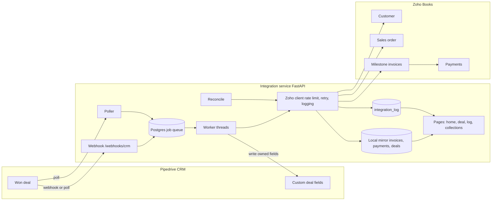
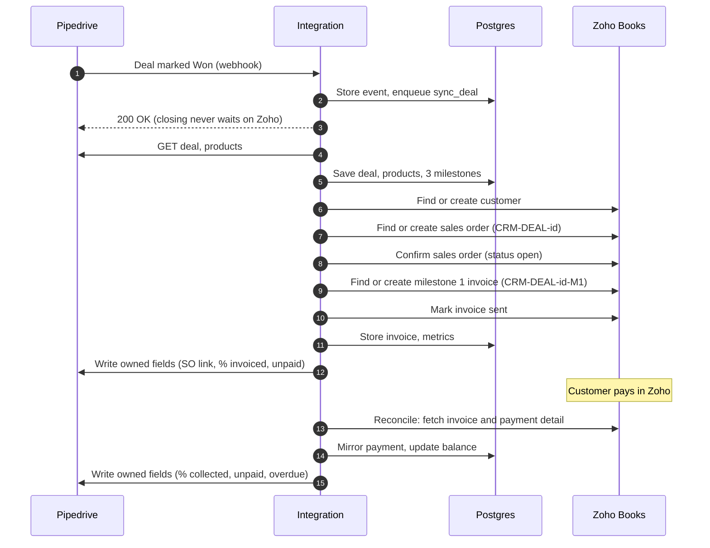

# CRM to Zoho Books integration

A backend integration that takes a **Closed Won deal in Pipedrive** (the CRM) and, in **Zoho Books** (accounting), creates the customer, a sales order and three milestone invoices. Payments and voids recorded in Zoho flow back to the deal. The integration is written in Python with FastAPI and Postgres (Supabase). No Zapier, Make, n8n, Zoho Flow or built-in connectors are used.

**CRM chosen:** Pipedrive (trial). Deals are custom-field driven, with a webhook and a poller as a safety net.

## Pages

| URL | What it shows |
|---|---|
| `/` | Home page with links |
| `/deals/2/view` | Full chain: sales order, milestone 1 invoice, payment, metrics, jobs, retry form |
| `/deals/18/view` | Overdue invoice and voided invoice |
| `/log` | Every Zoho and Pipedrive call, newest first. Filter by deal: `/log?deal=2` |
| `/collections` | Per customer: outstanding, aging buckets, oldest unpaid invoice, deals |
| `/health` | Health check |

Sample deals: **deal 2** (full sales order, a payment) and **deal 18** (one overdue invoice, one voided invoice).

## Setup

1. Python 3.13, then:
   ```powershell
   python -m venv .venv
   .venv\Scripts\activate
   pip install -r requirements.txt
   ```
2. Create a Supabase project. In the SQL Editor, run `schema.sql`, then the `alter table` statements in it.
3. Copy `.env.example` to `.env` and fill in:
   - `DATABASE_URL`: Supabase Session pooler string
   - `ZOHO_ACCOUNTS_URL`, `ZOHO_API_URL`, `ZOHO_ORG_ID`: region and organisation (`.com` here)
   - `ZOHO_CLIENT_ID`, `ZOHO_CLIENT_SECRET`, `ZOHO_REFRESH_TOKEN`: from a Zoho API Self Client with scope `ZohoBooks.fullaccess.all`
   - `CRM_BASE_URL`, `CRM_API_TOKEN`: your Pipedrive subdomain and personal API token
   - `WEBHOOK_SECRET`: a random string, also used as the admin key
4. One-time setup scripts:
   ```powershell
   python -m scripts.setup_crm_fields      # creates the custom deal fields in Pipedrive
   python -m scripts.setup_demo_items      # creates the demo service items and product mapping
   ```
5. Start the service:
   ```powershell
   python -m uvicorn app.main:app --port 8000
   ```
   The worker and poller start with the server.
6. Tests:
   ```powershell
   python -m pytest -q
   ```

Never commit `.env`. `.gitignore` already excludes it.

## Architecture



## Sequence diagram: Closed Won to paid



## Field mapping

Owner: **I** = integration writes it, **H** = human (sales or finance) enters it, **R** = read only by the integration.

| CRM field (Pipedrive) | Zoho Books field | Owner | Direction |
|---|---|---|---|
| Deal value | Sales order and invoice amounts (net, VAT added by tax) | H | CRM to Zoho |
| Deal organisation name | Customer `contact_name` and `company_name` | H | CRM to Zoho (match or create) |
| Customer TRN | Customer `tax_reg_no` and `tax_treatment` | H | CRM to Zoho |
| Deal products (name) | Line item `item_id` via `product_item_map` | H | CRM to Zoho (never guessed) |
| Go-Live Date | Milestone 2 and 3 due dates | H | CRM to Zoho |
| Deal status (won) | Triggers sales order creation | H | CRM to integration |
| Zoho Customer ID | `contacts.contact_id` | I | Zoho to CRM |
| Zoho Sales Order | `salesorders.salesorder_number` and link | I | Zoho to CRM |
| Zoho SO Total | `salesorders.total` (incl. VAT) | I | Zoho to CRM |
| Zoho % Invoiced | Computed from live invoices | I | Zoho to CRM |
| Zoho % Collected | Computed from payments applied | I | Zoho to CRM |
| Zoho Invoiced Unpaid | Sum of invoice balances | I | Zoho to CRM |
| Zoho Not Yet Invoiced | SO total minus invoiced | I | Zoho to CRM |
| Zoho Next Due Date | Earliest open invoice due date | I | Zoho to CRM |
| Zoho Overdue | Any open invoice past due | I | Zoho to CRM |
| Zoho Sync Status, Zoho Sync Error | Integration state and last error | I | Integration to CRM |

Written by the integration only when the value changes. Invoice and payment records are never edited by the integration in Zoho, except for marking an invoice sent.

## Money and idempotency

- Money is stored as integer minor units (fils). No floats.
- VAT is 5% (500 basis points), applied once on the net amount. Milestone splits use basis points, and the last milestone takes the remainder, so the parts add up exactly.
- Every Zoho create first searches by a deterministic reference: `CRM-DEAL-<id>` for the sales order, `CRM-DEAL-<id>-M<n>` for each invoice, and `CRM-DEAL-<id>-PAY...` for payments.
- Every CRM event is stored by a hash of its content. Each deal has one queued job per type (`sync_deal:<id>`, `process_deal:<id>`, `process_invoices:<id>`), so repeats merge.
- Crashes: a job stuck in `running` for over 5 minutes is picked up again. The sales order id is saved immediately after creation.

## API call counts

Counted from the `integration_log` table for deal 2 (`system = 'zoho'`).

- **One deal, Closed Won to paid:** deal 2 made **85 Zoho calls** and **58 Pipedrive calls** over its full lifecycle: customer and sales order creation, milestone 1 invoice, mark-as-sent, payment recording, reconcile passes and metrics write-back. This is an upper bound: it includes repeated test runs, retries and manual reconciles made during development. A single clean pass is lower.
- **One unchanged sync:** **0 Zoho calls** when no invoice or payment has changed. The poller checks Pipedrive for changed deals, and skips any deal whose update time has not changed. The Zoho reconcile re-reads each invoice and its candidate payments, so it costs roughly one call per invoice plus one per matching payment whenever it runs (every 5 hours by default).

## Section 5 answers

**1. Zoho Books is unreachable for six hours on the last day of the month.**
Pipedrive is unaffected, because closing a deal never waits on Zoho. Zoho calls that fail with network or 5xx errors are retried with backoff (30 s, doubling, capped at 1 h). The job stays in `retry`, and the deal shows the error in "Zoho Sync Error". Nothing is duplicated, because each create first searches by reference. When Zoho returns, the queue drains in order. An invoice due during the outage is raised late, not skipped.

**2. The deal is reopened after the first invoice was sent.**
The integration does not delete or change the invoice. If the deal is no longer Won, a sales order that already exists flags the deal "Needs review". Finance decides whether to void, credit or keep the invoice. No new milestone invoices are raised until a person clears the review.

**3. The deal amount changes after the sales order exists but before the second invoice.**
The sales order total is fixed in Zoho. The integration compares the new value with the stored amount and flags "Needs review" with old and new figures. Milestone 2 is not invoiced until Finance approves a revised sales order, so the invoices still add up to the order total.

**4. The CRM sends the same Closed Won event three times, out of order with an earlier stage change.**
Events are stored by a hash of their content, so exact duplicates are ignored. Order does not matter, because the handler reloads the current deal from Pipedrive rather than trusting the payload. Triggers for one deal merge into one queued job.

**5. An invoice is voided in Zoho Books and re-issued under a new number.**
The voided invoice is mirrored with status `void` and drops out of the metrics. The milestone keeps its link to the voided invoice. No automatic re-invoice is raised, because the replacement needs a person to confirm. Matching uses the milestone reference (`CRM-DEAL-<id>-M<n>`), not the invoice number, so a replacement can be linked to the same milestone.

**6. One payment is recorded against two invoices that belong to two different deals.**
Zoho stores each payment with per-invoice applied amounts. The integration mirrors only the amount applied to each invoice, so each deal sees just its own share. The customer's total is unchanged, and the collections page counts each invoice balance once.

**7. You reach Zoho Books' daily API limit in the afternoon.**
Finance still sees every existing invoice, payment and sales order in Zoho, because Zoho works for manual use. The CRM deal shows "Sync paused" in Zoho Sync Status with the Zoho error text. Queued jobs wait, and the worker parks them for an hour without using up retry attempts. After the midnight reset in the organisation's time zone, the queue resumes from where it stopped, with no lost or duplicated records.

## Reviewer guide

- **Public repository:** this repo. It contains no secrets; `.env` is git-ignored.
- **Deployed link:** `<add your deployed URL, or write "runs locally; see demo video">`
- **Pipedrive and Zoho Books:** trial workspaces. Access is shared in the submission form, not in this file.
- **Start with:** `/` → `/deals/2/view` (full chain) → `/log?deal=2` → `/collections`.
- **Retry button:** needs the admin key, shared in the submission form. It is a test key.
- **Demo video:** `<add link>`.

## Repository layout

- `app/`: integration code (Zoho and Pipedrive clients, job queue and worker, sync, invoicing, reconcile, pages)
- `tests/`: unit tests for money, customer matching, line mapping, schedule, metrics
- `scripts/`: setup and seed scripts
- `schema.sql`: database schema